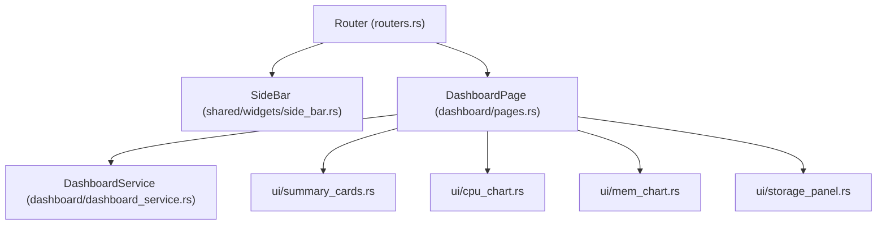

# Plan 01: Dashboard & Sidebar Navigation

## 1. Objectives
- Complete the **Sidebar** widget (`src/shared/widgets/side_bar.rs`) and integrate it into `Router` (`src/tuikk_core/routers.rs`) so users can navigate between `Dashboard`, `Containers`, and `Images` via keyboard (`Tab` / `BackTab`) and mouse (hover & left-click).
- Implement the **Dashboard** module (`src/modules/dashboard/`) displaying Docker Engine overview metrics and real-time charts:
  1. **CPU Usage Chart**: Time-series line `Chart` tracking aggregate CPU % and per-container CPU consumption.
  2. **RAM / Memory Usage Chart**: Time-series line `Chart` & `Gauge` tracking container RAM consumption against host/container memory limits.
  3. **Storage / Disk Memory Panel**: Breakdown of disk space occupied by containers (`size_rw` / `size_root_fs`), images, and volumes (`docker.df()`), alongside a per-container resource table (CPU %, RAM, Storage).
- Follow strict modular UI separation: keep `DashboardPage::draw()` concise by delegating each visual section to dedicated small UI files under `src/modules/dashboard/ui/`.
- Add unit tests in `src/tests/dashboard_test.rs`.

---

## 2. Architecture & Module Structure



```text
src/
├── shared/widgets/
│   └── side_bar.rs                  # Left navigation sidebar (render + mouse/key events)
├── modules/dashboard/
│   ├── mod.rs                       # Module exports
│   ├── actions.rs                   # DashboardAction enum (Refresh, Loaded)
│   ├── constants.rs                 # MAX_HISTORY_POINTS, DASHBOARD_REFRESH_TICKS, byte units
│   ├── dashboard_dto.rs             # ContainerResourceMetric, StorageSummary, DashboardSnapshot, MetricHistory
│   ├── dashboard_service.rs         # Bollard API calls (info, df, list_containers, stats) & pure calculations
│   ├── error.rs                     # DashboardError (#[extend_base_err])
│   ├── pages.rs                     # DashboardPage implementing Page trait
│   └── ui/
│       ├── mod.rs
│       ├── summary_cards.rs         # Top summary cards (Engine info, Containers state count, Images & Disk)
│       ├── cpu_chart.rs             # Real-time CPU % line Chart + Gauge
│       ├── mem_chart.rs             # Real-time RAM usage line Chart + Gauge
│       └── storage_panel.rs         # Storage distribution & per-container CPU/RAM/Disk table
└── tests/
    └── dashboard_test.rs            # Unit tests for DashboardService, CPU/RAM/Storage math & MetricHistory
```

---

## 3. Detailed Technical Design

### 3.1. Sidebar (`src/shared/widgets/side_bar.rs` & `src/tuikk_core/routers.rs`)
- Renders a fixed-width (`Constraint::Length(20)`) left panel listing `PAGES` (`Dashboard`, `Containers`, `Images`).
- Tracks `idx_page` (synced with `Router::current_route()`) and `hovered_idx`.
- Handles `MouseEventKind::Down(MouseButton::Left)` to emit `SideBarEvent::NavigatePage(route)`.

### 3.2. Data Transfer Objects (`dashboard_dto.rs`)
- `ContainerResourceMetric`:
  - `id: String`, `name: String`, `image: String`, `state: String`
  - `cpu_percent: f64`
  - `mem_usage: u64`, `mem_limit: u64`, `mem_percent: f64`
  - `storage_rw: u64`, `storage_rootfs: u64`
- `StorageSummary`:
  - `images_total_size: u64`, `images_reclaimable: u64`
  - `containers_total_size: u64`, `containers_reclaimable: u64`
  - `volumes_total_size: u64`
- `MetricHistory`:
  - Bounded `VecDeque<f64>` (`MAX_HISTORY_POINTS = 60`) for `cpu_points`, `mem_points`, and `storage_points`, exposing `cpu_dataset()` and `mem_dataset()` as `Vec<(f64, f64)>` for `ratatui::widgets::Chart`.

### 3.3. Resource Calculations (`dashboard_service.rs`)
- **CPU %**:
  $$\text{CPU\%} = \frac{\Delta \text{cpu\_usage.total\_usage}}{\Delta \text{system\_cpu\_usage}} \times \text{online\_cpus} \times 100.0$$
- **RAM Usage**:
  - `used_memory = memory_stats.usage.saturating_sub(cache)` (where `cache` is `inactive_file` or `cache` from `memory_stats.stats`).
  - `mem_percent = (used_memory as f64 / limit as f64) * 100.0`.
- **Storage Usage**:
  - Combines per-container `size_rw` and `size_root_fs` from `list_containers(size = true)` with system-wide `docker.df()` totals.

### 3.4. Small Embedded UI Files (`src/modules/dashboard/ui/`)
- `DashboardPage::draw()` splits the screen vertically into 3 regions and delegates rendering:
  1. `ui::summary_cards::draw(frame, summary_area, &self.snapshot, &self.theme_color)`
  2. `ui::cpu_chart::draw(frame, cpu_area, &self.snapshot, &self.history, &self.theme_color)` and `ui::mem_chart::draw(frame, mem_area, &self.snapshot, &self.history, &self.theme_color)`
  3. `ui::storage_panel::draw(frame, storage_area, &self.snapshot, self.cursor, self.offset, &self.theme_color)`

---

## 4. Test Plan (`src/tests/dashboard_test.rs`)
- `calculate_cpu_percent`: zero delta, multi-core scaling, missing `precpu_stats`.
- `calculate_mem_usage`: subtraction of `inactive_file`/`cache`, fallback to host memory limit, zero-limit safety.
- `MetricHistory`: bounded capacity eviction at `MAX_HISTORY_POINTS`, clamping to `0.0..=100.0`, dataset coordinate generation.
- `format_bytes`: human-readable conversion (`B`, `KB`, `MB`, `GB`, `TB`).
