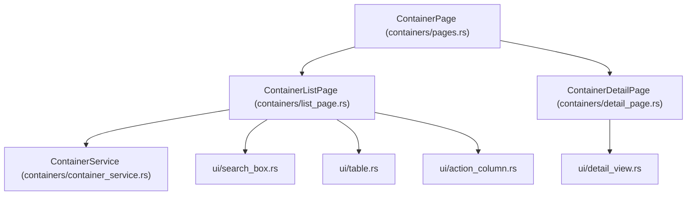

# Plan 02: Containers Module (Completion & UI Modularization)

## 1. Objectives
- Complete the in-progress **Containers** module (`src/modules/containers/`).
- Add missing container lifecycle operations in `ContainerService` and wire them to `ContainerListPage`:
  - **Start / Stop (`ToggleState`)**
  - **Restart (`Restart`)**
  - **Remove (`Remove`)**
  - **Sort (`CycleSort`, `ToggleOrder`)**
- Refactor the monolithic `draw` methods in `list_page.rs` and `detail_page.rs` into small, focused UI files under `src/modules/containers/ui/` for clean inheritance and maintainability.
- Enhance `ContainerDetailPage` with structured sections/tabs (`Overview`, `Network & Mounts`, `Env`, `Raw JSON`) and vertical scrolling (`Up` / `Down` / Mouse scroll).
- Add unit tests in `src/tests/containers_test.rs`.

---

## 2. Architecture & Module Structure



```text
src/
├── modules/containers/
│   ├── mod.rs
│   ├── actions.rs                   # ContainerAction & ButtonAction
│   ├── constants.rs                 # ContainerSort, ContainerDetailTab
│   ├── container_dto.rs             # RowTarget, RowButton, format_ports, short_id helpers
│   ├── container_service.rs         # Bollard API: list, inspect, start, stop, restart, remove, query/sort
│   ├── error.rs                     # ContainerError (#[extend_base_err])
│   ├── pages.rs                     # ContainerPage (List <-> Detail router)
│   ├── list_page.rs                 # ContainerListPage (state, events, delegates draw to ui/*)
│   ├── detail_page.rs               # ContainerDetailPage (state, scroll, tabs, delegates draw to ui/*)
│   └── ui/
│       ├── mod.rs
│       ├── search_box.rs            # Search input box + active sort/mode badge
│       ├── table.rs                 # Container table rendering
│       ├── action_column.rs         # Interactive Start/Stop & Remove buttons per visible row
│       └── detail_view.rs           # Structured Container inspect view with tabs & scroll
└── tests/
    └── containers_test.rs           # Unit tests for ContainerService, filter, sort, port formatting, cursor
```

---

## 3. Detailed Technical Design

### 3.1. `ContainerService` Extensions (`container_service.rs`)
- `start_container(&self, id: &str) -> Result<(), BaseErr>`
- `stop_container(&self, id: &str) -> Result<(), BaseErr>`
- `restart_container(&self, id: &str) -> Result<(), BaseErr>`
- `remove_container(&self, id: &str, force: bool) -> Result<(), BaseErr>`
- Extract pure formatting helpers (`format_ports`, `short_container_id`, `container_display_name`) into `container_dto.rs` so both UI components and unit tests can reuse them directly.

### 3.2. Lifecycle Action Handling (`list_page.rs`)
- When `ToggleState(id, should_start)`, `Restart(id)`, or `Remove(id)` is triggered (via action column buttons or keyboard commands `Command::Stop`, `Command::Restart`, `Command::Delete`):
  - Spawn an async task calling `ContainerService`.
  - Send `Action::Containers(ContainerAction::ActionCompleted(res))` back through `tx`.
  - Upon receiving `ActionCompleted`, automatically trigger `fetch()` to refresh the container list.

### 3.3. Small Embedded UI Files (`src/modules/containers/ui/`)
- `ContainerListPage::draw()` computes the layout rects and calls:
  - `ui::search_box::draw(frame, self.search_area, ...)`
  - `ui::table::draw(frame, table_area, ...)`
  - `ui::action_column::draw(frame, action_area, ...)`
- `ContainerDetailPage::draw()` delegates to `ui::detail_view::draw(frame, area, ...)`:
  - Renders container metadata header, tab bar (`1: Overview`, `2: Network & Mounts`, `3: Env`, `4: Raw JSON`), and scrollable content body.

---

## 4. Test Plan (`src/tests/containers_test.rs`)
- `ContainerSort::parse` & `ContainerSort::next`: ascending/descending prefixes (`name`, `-created`, `status`), invalid keys.
- `ContainerService::query_containers`: case-insensitive search across container name, image, and ID; filter map matching (`status`, `name`, `image`); sorting order.
- `format_ports`: deduplication of IPv4/IPv6 port bindings and protocol formatting (`tcp/8080:80`, `udp/53`).
- `ContainerListPage` selection and viewport clamping (`move_cursor`, `clamp`, `sync`).
