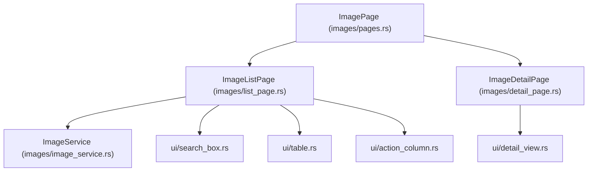

# Plan 03: Images Module

## 1. Objectives
- Implement the **Images** module (`src/modules/images/`) following the exact modular conventions and coding style of `containers`.
- Support core Docker Image management workflows:
  - **Image List (`ImageListPage`)**: local & remote search, filter, sort (`RepoTag`, `Id`, `Size`, `Created`, `Containers`), keyboard & mouse navigation.
  - **Image Actions**: remove image (`Remove`) via action column button or keyboard shortcut (`Command::Delete`), and prune dangling images (`Prune`).
  - **Image Detail (`ImageDetailPage`)**: inspect image metadata (`ImageInspect`), layers (`RootFS.Layers`), config/env/exposed ports, and raw JSON with scrolling and tabs.
- Separate all rendering logic into small UI files under `src/modules/images/ui/`.
- Add unit tests in `src/tests/images_test.rs`.

---

## 2. Architecture & Module Structure



```text
src/
├── modules/images/
│   ├── mod.rs
│   ├── actions.rs                   # ImageAction & ImageButtonAction
│   ├── constants.rs                 # ImageSort, ImageDetailTab
│   ├── image_dto.rs                 # ImageRowTarget, ImageRowButton, repo/tag/id/size formatters
│   ├── image_service.rs             # Bollard API: list_images, inspect_image, remove_image, prune_images, query
│   ├── error.rs                     # ImageError (#[extend_base_err])
│   ├── pages.rs                     # ImagePage (List <-> Detail router)
│   ├── list_page.rs                 # ImageListPage (state, search, mouse/key events, delegates draw to ui/*)
│   ├── detail_page.rs               # ImageDetailPage (state, scroll, tabs, delegates draw to ui/*)
│   └── ui/
│       ├── mod.rs
│       ├── search_box.rs            # Search input bar + sort indicator
│       ├── table.rs                 # Image table (ID, REPOSITORY, TAG, SIZE, CONTAINERS, CREATED)
│       ├── action_column.rs         # Interactive Remove button column
│       └── detail_view.rs           # Structured ImageInspect view (Overview, Layers, Config, Raw JSON)
└── tests/
    └── images_test.rs               # Unit tests for ImageService, filter, sort, repo:tag parsing, size formatting
```

---

## 3. Detailed Technical Design

### 3.1. `ImageService` (`image_service.rs`)
- Registered in `AppServices` as `pub images: Arc<ImageService>`.
- Core methods:
  - `fetch_images(&self, filter: &BaseFilter, all: Option<bool>) -> Result<Vec<ImageSummary>, BaseErr>`
  - `get_images(&self, filter: BaseFilter, all: Option<bool>) -> Result<Vec<ImageSummary>, BaseErr>`
  - `query_images<'a>(&self, items: &'a [ImageSummary], filter: &BaseFilter) -> Vec<&'a ImageSummary>`
  - `get_image(&self, id: &str) -> Result<ImageInspect, BaseErr>`
  - `remove_image(&self, id: &str, force: bool) -> Result<(), BaseErr>`
  - `prune_images(&self) -> Result<u64, BaseErr>`

### 3.2. DTO & Formatting Helpers (`image_dto.rs`)
- `parse_repo_tag(image: &ImageSummary) -> (String, String)`:
  - Splits the primary tag in `repo_tags` on the last `:` (correctly handling registry ports such as `localhost:5000/my-app:1.0.0` -> `("localhost:5000/my-app", "1.0.0")`, and untagged images -> `("<none>", "<none>")`).
- `short_image_id(id: &str) -> &str`:
  - Strips the optional `"sha256:"` prefix and slices up to 12 characters.
- `format_image_size(bytes: i64) -> String`:
  - Converts byte count into human-readable units (`KB`, `MB`, `GB`).

### 3.3. Small Embedded UI Files (`src/modules/images/ui/`)
- `ImageListPage::draw()` splits the page into search bar, table, and action column, calling:
  - `ui::search_box::draw`
  - `ui::table::draw`
  - `ui::action_column::draw`
- `ImageDetailPage::draw()` calls `ui::detail_view::draw` to render the inspect view with tabs (`Overview`, `Layers`, `Config & Env`, `Raw JSON`) and line scrolling.

---

## 4. Test Plan (`src/tests/images_test.rs`)
- `ImageSort::parse` & sorting comparators (`RepoTag`, `Id`, `Size`, `Created`, `Containers`).
- `ImageService::query_images`: case-insensitive search by repository, tag, or image ID; filter matching.
- `parse_repo_tag`: standard tags, registry host with port (`registry:5000/org/img:v2`), untagged images.
- `short_image_id`: stripping `sha256:` prefix and handling short strings safely.
