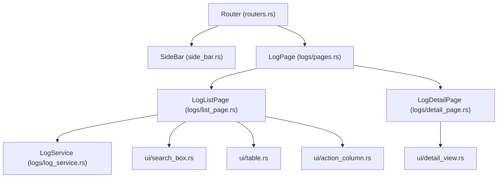

# Plan 04: Logs Module (Error Log Viewer & File Deletion)

## 1. Objectives
- Implement the **Logs** module (`src/modules/logs/`) to inspect application & Docker operation logs stored in the user-configured `log_dir` (`AppConfig.log_dir`).
- Provide fast visibility into **important error and warning logs** (`ERROR`, `WARN`) as well as full log entries.
- Support **deleting log files** (`Delete` single file via mouse button or `<d>` key, `Clear/Truncate` file content, and `Delete All` old log files).
- Follow the exact modular architecture and small `ui/*` file pattern used in `containers` and `images`.
- Register `Route::Logs` in `SideBar` and `Router`.
- Add comprehensive unit tests in `src/tests/logs_test.rs`.

---

## 2. Architecture & Module Structure



```text
src/
├── tuikk_core/
│   └── logging.rs                   # Expose resolve_log_dir(&Option<String>) -> PathBuf
├── modules/logs/
│   ├── mod.rs
│   ├── actions.rs                   # LogAction & LogButtonAction
│   ├── constants.rs                 # LogSort, LogLevelFilter, LogDetailTab
│   ├── error.rs                     # LogError (#[extend_base_err])
│   ├── log_dto.rs                   # LogFileSummary, LogEntry, LogLevel, LogRowTarget, LogRowButton
│   ├── log_service.rs               # List, parse, filter, delete, and clear log files in configured log_dir
│   ├── pages.rs                     # LogPage (List <-> Detail router)
│   ├── list_page.rs                 # LogListPage (file list, error/warn counts, delete action, delegates draw to ui/*)
│   ├── detail_page.rs               # LogDetailPage (level filter tabs: Errors/Warns/All, scroll, delete file)
│   └── ui/
│       ├── mod.rs
│       ├── search_box.rs            # Search bar + configured log_dir path & sort indicator
│       ├── table.rs                 # Log files table (FILENAME, SIZE, ERRORS, WARNINGS, LINES, MODIFIED)
│       ├── action_column.rs         # Per-row Delete (Remove) button
│       └── detail_view.rs           # Color-coded log entries viewer with level filter tabs & scroll
└── tests/
    └── logs_test.rs                 # Unit tests for log parsing, level filtering, sorting, and file deletion
```

---

## 3. Detailed Technical Design

### 3.1. Resolving the User-Configured Log Directory (`src/tuikk_core/logging.rs`)
- Extract `pub fn resolve_log_dir(custom_log_dir: &Option<String>) -> PathBuf`:
  - Uses `AppConfig::global().log_dir` when set (e.g., `"./logs"` in `.config/config.toml`), or falls back to the platform XDG data directory (`~/.local/share/tuikk/logs`).

### 3.2. Data Models (`log_dto.rs`)
- `LogLevel`: `Error`, `Warn`, `Info`, `Debug`, `Trace`, `Unknown`.
- `LogEntry`:
  - `line_number: usize`
  - `timestamp: String`
  - `level: LogLevel`
  - `target: String`
  - `message: String`
  - `raw: String`
- `LogFileSummary`:
  - `file_name: String`
  - `path: PathBuf`
  - `size: u64`
  - `modified_epoch: u64`
  - `total_lines: usize`
  - `error_count: usize`
  - `warn_count: usize`
  - `last_error_preview: Option<String>`

### 3.3. `LogService` Operations (`log_service.rs`)
- `list_log_files(&self, filter: &BaseFilter) -> Result<Vec<LogFileSummary>, BaseErr>`:
  - Scans `log_dir` for `.log` files, counts `ERROR` and `WARN` lines, extracts the latest error preview, and applies search/sort.
- `read_log_entries(&self, file_name: &str, level_filter: LogLevelFilter, search: Option<&str>) -> Result<Vec<LogEntry>, BaseErr>`:
  - Reads and parses lines from `log_dir.join(file_name)` and filters by severity (`ErrorsOnly`, `WarnAndError`, `All`).
- `delete_log_file(&self, file_name: &str) -> Result<(), BaseErr>`:
  - Validates that `file_name` is a direct child of `log_dir` (preventing path traversal) and removes the file via `std::fs::remove_file`.
- `clear_log_file(&self, file_name: &str) -> Result<(), BaseErr>`:
  - Truncates the file to 0 bytes (`std::fs::write(&path, "")`) without removing the file descriptor.
- `delete_all_logs(&self) -> Result<usize, BaseErr>`:
  - Removes all `.log` files in `log_dir` and returns the number of deleted files.

### 3.4. Small Embedded UI Files (`src/modules/logs/ui/`)
- `LogListPage::draw()` delegates to:
  - `ui::search_box::draw`: shows search input, configured `log_dir` path, and active sort key.
  - `ui::table::draw`: renders `FILE NAME`, `SIZE`, `ERRORS`, `WARNINGS`, `LINES`, and `LAST ERROR / STATUS` with red/yellow highlights on files containing errors or warnings.
  - `ui::action_column::draw`: renders the interactive `Remove` (`Delete`) button for each log file row.
- `LogDetailPage::draw()` delegates to:
  - `ui::detail_view::draw`:
    - Header with file name, size, error/warn badges, and key hints (`[Esc: Back | 1-4: Filter Level | d: Delete File | c: Clear File | j/k: Scroll]`).
    - Tabs: `1. Errors & Warnings` (default so important issues appear immediately), `2. Errors Only`, `3. All Logs`, `4. Raw`.
    - Color-coded log lines (`ERROR` in `theme.error`, `WARN` in `theme.warning`, `INFO` in `theme.info`).

---

## 4. Test Plan (`src/tests/logs_test.rs`)
- `parse_log_line`: parses `tracing_subscriber` formatted lines (`2026-10-19T15:10:47.444708Z WARN ThreadId(01) target: msg`) into `LogEntry` with accurate `LogLevel`, timestamp, target, and message.
- `LogService` in a temporary directory:
  - Creates sample `.log` files with `INFO`, `WARN`, and `ERROR` lines.
  - Verifies `list_log_files` counts `error_count` and `warn_count` accurately and sorts by name/size.
  - Verifies `read_log_entries` with `LogLevelFilter::ErrorsOnly` and `LogLevelFilter::WarnAndError`.
  - Verifies `delete_log_file`, `clear_log_file`, and path-traversal rejection (`../outside.log`).
- `LogListPage`: verifies cursor movement, sorting, and `Command::Delete` returning `Action::Logs(LogAction::DeleteFile(...))`.

