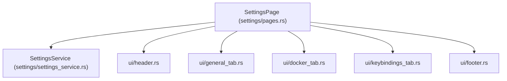

# Plan 05: Settings Module (`src/modules/settings`)

## 1. Objectives
- Implement the **Settings** module (`src/modules/settings/`) following the modular architecture of `containers`, `images`, and `logs`.
- Allow users to inspect, modify, and persist application configuration (`AppConfig` in `config.toml`), test/reload the Docker Engine connection (`DockerConnection`), and view active keybindings (`keybindings.toml`).
- Keep `draw()` concise by delegating all UI rendering to small sub-modules under `src/modules/settings/ui/`.
- Add unit tests in `src/tests/settings_test.rs`.

---

## 2. Architecture & Module Structure



```text
src/
├── modules/settings/
│   ├── mod.rs
│   ├── actions.rs                   # SettingsAction
│   ├── constants.rs                 # SettingsTab, GeneralField, DockerField
│   ├── error.rs                     # SettingsError (#[extend_base_err])
│   ├── settings_dto.rs              # SettingsDraft, KeybindingRow, option cycling helpers
│   ├── settings_service.rs          # SettingsService (load/save AppConfig, reload/ping Docker, extract keybindings)
│   ├── pages.rs                     # SettingsPage (tabs, field editing, keyboard/mouse handlers, delegates draw)
│   └── ui/
│       ├── mod.rs
│       ├── header.rs                # Config path info, tab bar, status/error feedback
│       ├── general_tab.rs           # Theme, IconSet, QueryMode, LogLevel, LogDir, FrameRate, TickRate
│       ├── docker_tab.rs            # ConnectionType, Addr/Path, Timeout, ClientVersion, Ping button
│       ├── keybindings_tab.rs       # Scrollable table of active keybindings by scope
│       └── footer.rs                # Save (Ctrl+S), Reload, Defaults, and Ping buttons
└── tests/
    └── settings_test.rs             # Unit tests for SettingsDraft, option cycling, validation, and keybinding extraction
```

---

## 3. Detailed Technical Design

### 3.1. `SettingsTab` (`constants.rs`)
- `1. General & UI`:
  - `Theme` (`dark`, `light`)
  - `IconSet` (`ascii`, `unicode`, `nerd`)
  - `QueryMode` (`local`, `remote`)
  - `LogLevel` (`error`, `warn`, `info`, `debug`, `trace`)
  - `LogDir` (custom log directory path)
  - `FrameRate` (`1.0..=240.0` FPS)
  - `TickRate` (`1.0..=240.0` Hz)
- `2. Docker Engine`:
  - `ConnectionType` (`socket`, `local`, `http`)
  - `AddrOrPath` (socket path or HTTP/TCP endpoint)
  - `Timeout` (seconds)
  - `ClientVersion` (optional Docker API version, e.g. `1.45`)
- `3. Keybindings`:
  - Read-only scrollable table of `(Scope, Key Sequence, Command)` extracted from `AppConfig.keybindings`.

### 3.2. `SettingsService` (`settings_service.rs`)
- `load_draft(&self) -> SettingsDraft`: builds a mutable form draft from `AppConfig::global()`.
- `save_draft(&self, draft: &SettingsDraft) -> Result<AppConfig, String>`: validates fields, applies changes onto `AppConfig`, and persists via `AppConfig::update_global`.
- `reload_and_ping_docker(&self, draft: &SettingsDraft) -> Result<String, String>`: reloads `DockerConnection` with the draft's `DockerConfig` and executes `DockerConnection::ping().await`.
- `extract_keybindings(keymap: &KeyMap) -> Vec<KeybindingRow>`: returns sorted `(scope, key_seq, command)` rows.

---

## 4. Test Plan (`src/tests/settings_test.rs`)
- `SettingsTab`, `GeneralField`, and `DockerField` cycling (`next` / `prev`).
- `SettingsDraft` option cycling (`cycle_theme`, `cycle_icon_set`, `cycle_query_mode`, `cycle_log_level`, `cycle_conn_type`) and numeric adjustments (`adjust_frame_rate`, `adjust_tick_rate`, `adjust_timeout`).
- `SettingsDraft::apply_to_config`: validates and converts draft values into `AppConfig`.
- `SettingsService::extract_keybindings`: deterministic sorting of keybindings by scope and key sequence.

